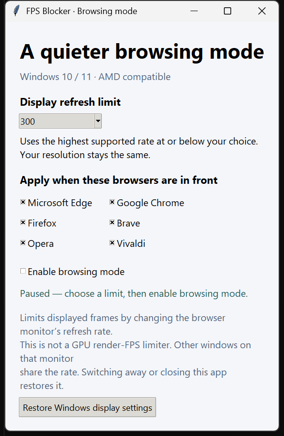

# FPS Blocker

[](https://github.com/SkyOne771/fps-blocker/actions/workflows/check.yml)
[](https://www.python.org/downloads/windows/)
[](LICENSE)

**A Windows desktop utility for browser-aware display refresh control and reversible AMD FreeSync diagnostics.**

FPS Blocker detects the foreground browser, applies a supported refresh-rate limit to its monitor, and restores the original rate when you switch away. Built with Python, Tkinter, and direct Win32 bindings through `ctypes`; the main application has no third-party Python dependencies.

> Despite the name, this app limits **display refresh rate (Hz)**. It does not cap the frames an application renders on the GPU or the frames decoded from video. Selecting 300 Hz on a 240 Hz monitor leaves it at 240 Hz.



## Features

- **Browser-aware switching:** Chrome, Edge, Firefox, Brave, Opera, and Vivaldi.
- **Multiple monitors:** follows the foreground browser's monitor and restores the previous monitor on handoff.
- **21 refresh presets:** 24–540 Hz, including 60, 120, 144, 165, 240, 300, and 360 Hz. Only driver-reported modes at the existing resolution are eligible.
- **Reversible changes:** restores the original rate on pause, normal exit, or switching to another app. Failed restoration retains the original mode for retry.
- **AMD diagnostics:** an optional command-line tool inspects FreeSync, backs up its state before disabling it, verifies readback, and supports restoration.
- **Automated checks:** unit tests plus Windows CI checks for native structure layout and API binding.
- **Documentation checks:** CI requires a README or technical-doc update alongside runtime/workflow changes and validates local documentation links and images.

## Quick start

**Requirements:** Windows 10/11 and Python 3.10+ with Tkinter. Use 64-bit Windows Python for the optional AMD diagnostic tool. No administrator privileges are required for the main application.

```powershell
git clone https://github.com/SkyOne771/fps-blocker.git
cd fps-blocker
py -3 -m fps_blocker
```

Alternatively, download and extract the [source ZIP](https://github.com/SkyOne771/fps-blocker/archive/refs/heads/main.zip), then double-click `start.bat`. The launcher also searches the standard per-user Python installation directory if `py.exe` is unavailable.

1. Choose a refresh limit. The selected default is **300 Hz**; choose a lower supported rate to reduce display refreshes.
2. Select the browsers you want to include.
3. Enable **browsing mode**, leave the utility running, and switch to a selected browser.
4. Switch to another app, disable browsing mode, or close the utility to restore the previous rate.

The app chooses the highest supported rate at or below your limit and never raises an already lower rate. If no compatible mode exists, it reports the problem and pauses. Other windows on the same monitor share its refresh rate.

## AMD FreeSync and dark-area flicker

The separate diagnostic tool was added after an investigation on an **RX 7900 XTX / AORUS FO32U2P OLED** system. Disabling FreeSync stopped the user's reported dark-area flicker while preserving 3840×2160 at 240 Hz. This is a result on one system, not a universal OLED flicker fix.

Inspect settings without changing them:

```powershell
py -3 tools/amd_freesync.py
```

Disable FreeSync on a specific monitor, with a backup and driver readback verification:

```powershell
py -3 tools/amd_freesync.py --monitor "AORUS FO32U2P" --disable
```

Restore the saved setting:

```powershell
py -3 tools/amd_freesync.py --monitor "AORUS FO32U2P" --restore
```

The exact monitor name must match the diagnostic output. The default name is `AORUS FO32U2P`; `restore-freesync.bat` is a shortcut for restoring that monitor. The tool requires an AMD driver exposing the relevant ADL APIs. Unsupported displays are reported rather than modified.

The original setting is saved to `freesync-backup.json`, which Git ignores. Existing backups are never overwritten. No persistence flush is requested, so the change may reset after reboot. See the [investigation and recovery notes](docs/troubleshooting.md).

## How it works

Every 750 ms, the application reads the foreground process and monitor. Its controller decides whether to apply or restore a refresh rate. The Win32 adapter enumerates supported modes, preserves resolution and orientation, tests the requested change, and applies it without updating the saved Windows display configuration.

The AMD tool uses ADL's display enumeration and FreeSync APIs, identifies the owning logical adapter, and stores the previous setting before making a change.

Read the [architecture and design decisions](docs/architecture.md) for the control flow, native API boundary, and failure handling.

## Testing

Run the automated suite from the repository root:

```powershell
py -3 -m unittest discover -s tests -v
```

Controller and diagnostic policy tests use fake hardware adapters and also run on Linux. GitHub Actions runs the suite on Windows and checks the native structure sizes and API binding. CI does not verify a physical monitor's behavior.

Optional manual Windows checks:

```powershell
py -3 tests/windows_smoke.py
# Briefly changes the foreground monitor to a supported rate at or below 60 Hz:
py -3 tests/windows_smoke.py --switch
```

The switching check verifies the active rate and resolution, restores the original mode, and starts a separate recovery process in case the test terminates unexpectedly. A local hardware run verified **4K at 240 Hz → 60 Hz → 240 Hz**. See [validation evidence and limits](docs/architecture.md#validation).

## Limitations

- This is an early desktop utility distributed as Python source, without an installer or packaged executable.
- Monitor mode changes can briefly blank the screen. Restoration follows the polling interval rather than happening instantly.
- A forced termination can leave the temporary rate active. The **Restore Windows display settings** button resets **all displays** to the configuration saved in Windows; it does not restore FreeSync settings.
- HDR, dynamic refresh rate, remote desktops, display hot-plugging, and unusual multi-monitor layouts need broader hardware testing. The app does not manage FreeSync automatically.
- No measured power-saving or system-wide GPU FPS-cap claims are made.

## Contributing and license

See [CONTRIBUTING.md](CONTRIBUTING.md) for setup, checks, and useful bug-report details. Contributions and issue reports are welcome.

Documentation is maintained with the code: every push and pull request runs a
documentation check. Runtime or workflow changes must include a `README.md` or
`docs/*.md` update in the compared change. The check also catches missing local
link and image targets. Contributors still review the prose for accuracy; CI
cannot verify that an explanation matches the behavior. Future coding agents
receive the same maintenance instructions in [AGENTS.md](AGENTS.md).

Released under the [MIT License](LICENSE).

## References

- [Microsoft: ChangeDisplaySettingsExW](https://learn.microsoft.com/en-us/windows/win32/api/winuser/nf-winuser-changedisplaysettingsexw)
- [AMD GPUOpen: ADL display and FreeSync APIs](https://gpuopen-librariesandsdks.github.io/adl/display_8h.html)
- [AMD: Radeon Chill compatibility](https://www.amd.com/en/products/software/adrenalin/radeon-software-chill.html)
